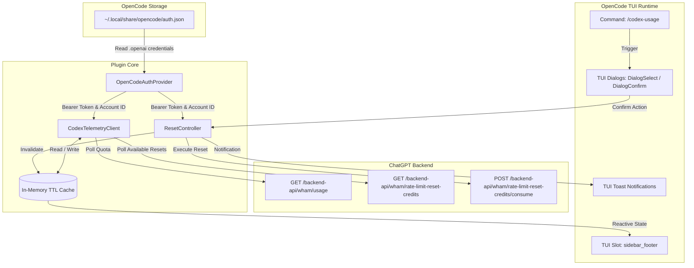
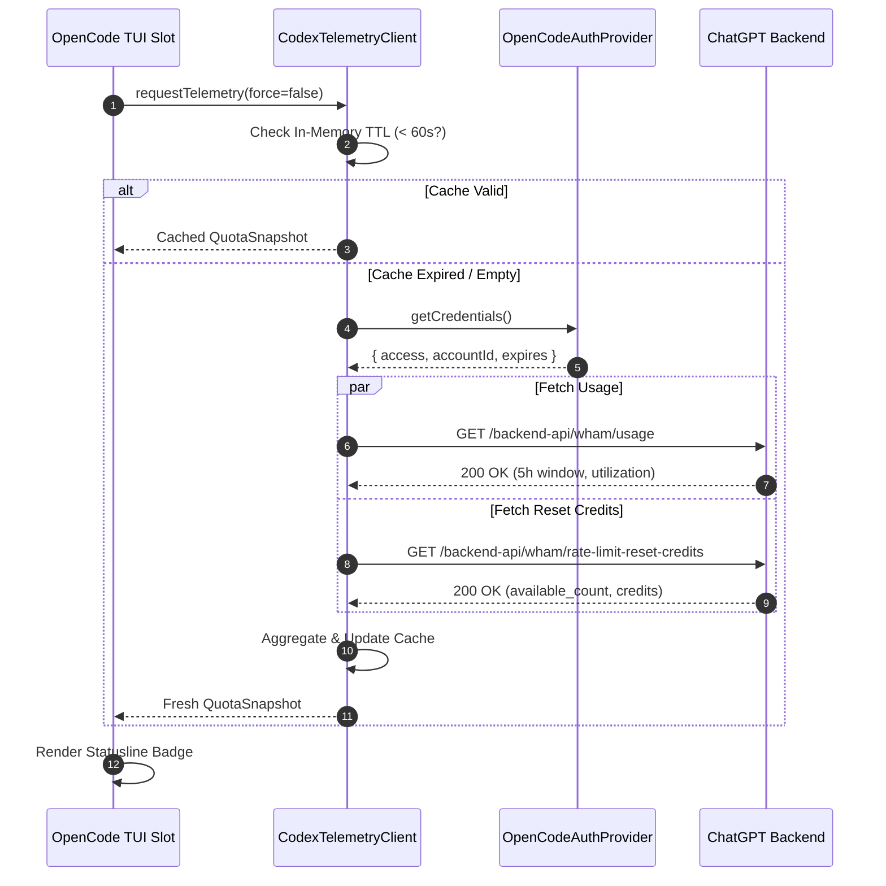
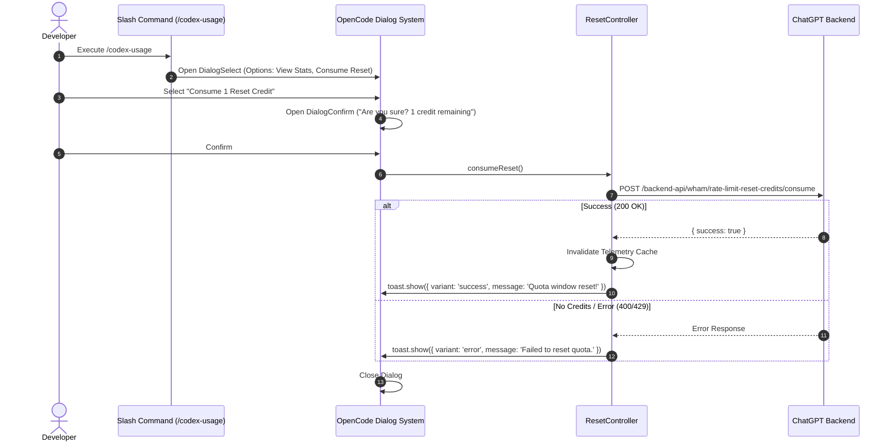

# System Architecture

## 1. Executive Summary & Problem Context

OpenCode developers using OpenAI/ChatGPT subscription models (Plus, Pro, Team) share agentic execution quota across background tools, subagents, and chat sessions. This quota is governed by **5-hour rolling windows** and **weekly caps**, rather than simple per-token API billing.

Without immediate feedback within OpenCode's Terminal User Interface (TUI), developers encounter unexpected `429 Too Many Requests` or degraded response performance.

The **`opencode-codex-quota`** plugin bridges OpenCode's native TUI lifecycle with ChatGPT's backend telemetry, delivering ambient awareness and interactive reset capabilities without requiring third-party background daemons or external tooling dependencies.

---

## 2. Core Architectural Principles

1. **Decoupled & Self-Contained**: Must not depend on `~/.codex/auth.json` or external CLI agents. It relies solely on OpenCode's own state store (`~/.local/share/opencode/auth.json`).
2. **Ambient Visibility without Noise**: Information is placed in non-intrusive TUI slots (`sidebar_footer` or `session_prompt_right`), escalating to toasts only when thresholds (e.g., 85%) are breached.
3. **Defensive Telemetry**: Strict in-memory TTL caching (default: 60s) prevents hammering the OpenAI backend API during active subagent runs.
4. **Guarded State Mutation**: Rate-limit resets are scarce. Consuming a credit requires explicit confirmation via `api.ui.DialogConfirm` and unique client-generated idempotency keys.
5. **Graceful Degradation**: If auth is absent, expired, or network fails, the plugin renders a neutral fallback state (`[Codex: Off]`) without throwing uncaught exceptions or crashing OpenCode's TUI.

---

## 3. High-Level Component Architecture

---

## 4. Module Breakdown & Responsibilities

### 4.1. `OpenCodeAuthProvider`
- **Location**: `src/auth/provider.ts`
- **Responsibility**: 
  - Resolves OpenCode's state directory via `api.state.path.state` (or `$XDG_DATA_HOME/opencode`).
  - Reads and parses `auth.json`.
  - Extracts `.openai` credentials (`access`, `accountId`, `expires`, `type`).
  - Verifies token expiration against current system time (`Date.now() < expires`).

### 4.2. `CodexTelemetryClient`
- **Location**: `src/telemetry/client.ts`
- **Responsibility**:
  - Implements HTTP requests to ChatGPT backend using native `fetch`.
  - Standardizes headers (`Authorization: Bearer <access>`, `ChatGPT-Account-Id: <accountId>`, `User-Agent: codex`, `Accept: application/json`).
  - Normalizes responses into domain models (`QuotaSnapshot`, `ResetCreditsSnapshot`).
  - Maintains a 60-second in-memory cache to throttle outgoing network requests.

### 4.3. `ResetController`
- **Location**: `src/actions/reset-controller.ts`
- **Responsibility**:
  - Validates that `available_count > 0` before initiating any consumption.
  - Generates an `idempotency_key` formatted as `consume-rate-limit-reset-${Date.now()}`.
  - Dispatches `POST /backend-api/wham/rate-limit-reset-credits/consume`.
  - Invalidate telemetry cache upon success and triggers an immediate refresh.

### 4.4. `TuiPresentationLayer`
- **Location**: `src/tui/plugin.tsx`
- **Responsibility**:
  - Registers slot component (`sidebar_footer`) rendering compact status indicators.
  - Registers slash command (`/codex-usage`) in OpenCode's command registry.
  - Renders interactive selection and confirmation dialogs using OpenCode's native dialog stack (`api.ui.dialog`, `api.ui.DialogConfirm`).
  - Dispatches visual warnings via `api.ui.toast`.

---

## 5. Sequence Diagrams

### 5.1. Background Polling & Ambient Rendering

### 5.2. Interactive Quota Reset Flow

